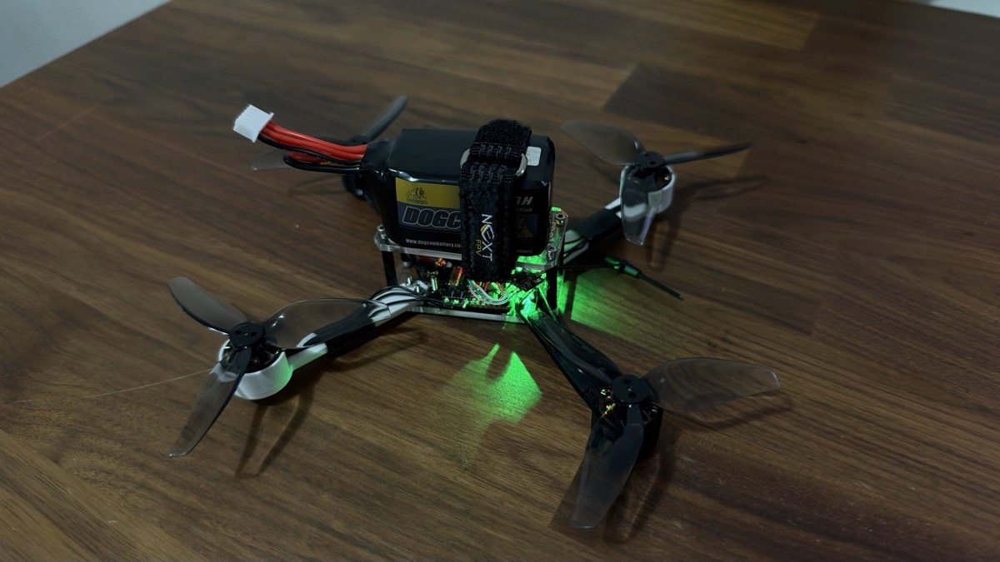

# Personal site

The whole site is one file, [`index.html`](index.html), plus your images. There's no build step and nothing to install.

---

## Preview it while you edit

In Terminal:

```
cd ~/Portfolio
python3 dev.py
```

Open **http://localhost:3000**. Every time you save a file, the page refreshes by itself. To stop the server, press **Ctrl + C**.

`dev.py` only runs on your computer. It isn't part of the live website.

---

## Quick HTML cheat sheet

You only need these:

| You want | You write |
|---|---|
| A paragraph | `<p>Your text here.</p>` |
| A link | `<a href="https://example.com">link text</a>` |
| (Links to other websites open in a new tab automatically.) | |
| An email link | `<a href="mailto:you@email.com">email me</a>` |
| **Bold** text | `<strong>bold</strong>` |
| *Italic* text | `<em>italic</em>` |
| A small heading inside a pop-up | `<h4>Heading</h4>` |
| A bullet list | `<ul>` then one `<li>item</li>` per line, then `</ul>` |
| A numbered list | the same, with `<ol>` and `</ol>` |
| A line break | `<br>` |

Anything written between `<!--` and `-->` is a note. It doesn't show on the site.

---

## Images

1. Put the image in the `images/` folder. JPG, PNG, WebP and GIF all work.
2. Refer to it as `images/your-file-name.jpg`. Filenames are case-sensitive, so `Drone.JPG` and `drone.jpg` are different files.

**Tips**
- Thumbnails are cropped to a 3:2 shape (for example 1200×800), and the large image at the top of a pop-up is cropped to 16:9. Any size works, because the image fills the box without stretching.
- Keep files under about 500 KB so the site stays fast. [squoosh.app](https://squoosh.app) shrinks images for free.
- `me.jpg` is only used as the preview image when someone shares your link. Replace it with a square photo of the same name.

---

## Projects

Each project is one `<article>` block. Here's an example with notes on every part:

```html
<article class="project" id="drone">                <!-- id: short, lowercase, no spaces. Must be unique. -->
  <button class="thumb" data-open aria-label="Open Drone">
                   <!-- thumbnail (also used as the pop-up's top image) -->
  </button>
  <div class="info">
    <div class="title-row">
      <h3>Drone</h3>                                  <!-- project name -->
      <span class="icons">                            <!-- icons: keep the ones you want, delete the rest -->
        <a class="icon github"   href="https://github.com/dvntekim/drone" aria-label="GitHub"></a>
        <a class="icon x"        href="https://x.com/dvnyy/status/123"   aria-label="X"></a>
        <a class="icon linkedin" href="https://linkedin.com/..."         aria-label="LinkedIn"></a>
        <a class="icon link"     href="https://anything.com"             aria-label="Website"></a>
      </span>
    </div>
    <p class="skills">MATLAB · DSP</p>                <!-- skills line (small grey italic text). Delete it if you don't want one. -->
    <p>One line about the project.</p>                <!-- short description -->
    <button class="more" data-open>Read more <span>→</span></button>
  </div>
  <template>
    <!-- Everything in here appears in the pop-up. -->
    <p>Write as much as you like.</p>
  </template>
</article>
```

### Add a project
Copy a whole `<article> … </article>` block, paste it where you want it to appear, then change the `id`, image, name, icons, description and pop-up content.

### Reorder projects
Cut a whole `<article> … </article>` block and paste it somewhere else. Projects appear in the order they're written in the file.

### Remove a project
Delete its whole `<article> … </article>` block.

### Show a project without a pop-up
Delete its `<template> … </template>` block. The "Read more" link disappears automatically.

### Icons
There are four icon types: `github`, `x`, `linkedin` and `link` (an arrow for any other website). To add or remove an icon, add or delete its `<a class="icon …">` line. Point each one at the specific repo or post, not just your profile.

### Share a link to one project
Add `#` and the project's id to the end of your site's address, for example `yoursite.com/#drone`. The page opens with that project's pop-up already showing.

---

## What you can put in a pop-up

Put any of these inside a project's `<template> … </template>`.

**Text and headings**
```html
<p>Built in 3 weeks with <strong>PyTorch</strong>.</p>
<h4>How it works</h4>
<p>More text, with a <a href="https://arxiv.org/abs/1234">link to the paper</a>.</p>
```

**Bullet list**
```html
<ul>
  <li>First point</li>
  <li>Second point</li>
</ul>
```

**Image** (fills the width of the pop-up)
```html

```

**Image with a caption**
```html
<figure>
  
  <figcaption>First stable hover, March 2026</figcaption>
</figure>
```

**Video file** (save it in `images/`; keep it short and small)
```html
<video src="images/demo.mp4" controls muted playsinline></video>
```

**YouTube video:** on YouTube, click **Share → Embed** and copy the video ID from the link it shows.
```html
<iframe src="https://www.youtube.com/embed/VIDEO_ID" allowfullscreen></iframe>
```

---

## Sections ("Projects", "Crypto", …)

A section is just a heading followed by `<article>` blocks:

```html
<h2>Hackathons</h2>

<article class="project" id="...">…</article>
<article class="project" id="...">…</article>
```

To add a new section, paste this anywhere between the other sections. To rename one, change the text inside `<h2>…</h2>`.

---

## Everything else

- **Intro text:** the `<p>` lines under `<h1>Daniel Kim</h1>`.
- **Social links under your name:** the `<nav class="socials">` block. Add, remove or reorder its `<a>` lines.
- **Google and link-preview text:** the `description` lines at the very top of the file.
- **Colours:** the `--bg`, `--text` and similar values near the top of the `<style>` block.

If something breaks, it's almost always a missing closing tag (for example a `<p>` without its `</p>`) or a missing quote mark in `href="…"`. If you open `index.html` in VS Code, it highlights tags that don't match.

---

## Put it online (free)

1. Create a GitHub repo and push this folder to it.
2. On [vercel.com](https://vercel.com), click **Add New → Project**, import the repo, and deploy. Leave every setting at its default. Cloudflare Pages, Netlify or GitHub Pages also work.
3. From then on, every `git push` updates the live site.

**Custom domain (~US$10–15/year):** buy one from Cloudflare, Porkbun or Namecheap. In Vercel, add it under **Project → Settings → Domains**, then copy the DNS records Vercel shows you into your registrar's settings. After that, change `og:image` at the top of `index.html` to the full URL, for example `https://yourdomain.com/me.jpg`.
